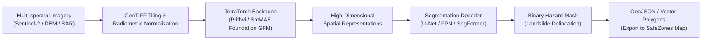

# 🛰️ ML — Geospatial Foundation Models & Remote Sensing Research

> **Deep Learning, Earth Observation (EO) & Satellite Semantic Segmentation for Landslide Risk Detection**

[](https://pytorch.org/)
[](https://github.com/IBM/terratorch)
[](https://torchgeo.readthedocs.io/)
[](https://lightning.ai/)
[](https://rasterio.readthedocs.io/)

---

## 📋 Table of Contents

- [Overview](#-overview)
- [Research Scope & Methodology](#-research-scope--methodology)
- [Tech Stack & Geospatial Tooling](#-tech-stack--geospatial-tooling)
- [Directory Structure](#-directory-structure)
- [Interactive Notebooks & Workflow](#-interactive-notebooks--workflow)
  - [`bacha.ipynb` Walkthrough](#bachaipynb-walkthrough)
- [Model Architecture & Foundation Models](#-model-architecture--foundation-models)
- [Environment Setup & Installation](#-environment-setup--installation)
  - [Prerequisites & CUDA](#prerequisites--cuda)
  - [Installation Steps](#installation-steps)
- [Downstream Integration](#-downstream-integration)

---

## 🧭 Overview

The **ML** research module hosts deep learning workflows, Earth observation data pipelines, and geospatial foundation models (GFMs) for automatic landslide identification and terrain vulnerability mapping.

Using multispectral satellite imagery (Sentinel-2, Landsat, and DEM elevation rasters), this module trains and evaluates high-resolution semantic segmentation models capable of delineating active landslide scars, unstable talus slopes, and debris flow channels.

---

## 🔬 Research Scope & Methodology

1. **Multispectral Earth Observation (EO)**:
   - Ingestion of optical bands (RGB, NIR, RedEdge, SWIR) and radar/topographic data (SAR backscatter, slope, aspect, curvature).
   - Vegetation index computations (NDVI, NDWI) to detect anomalous bare soil signatures resulting from mass wasting events.

2. **Geospatial Foundation Models (GFMs)**:
   - Leveraging pre-trained foundation models such as **Prithvi** (IBM/NASA geospatial foundation model) and **SatMAE** via **TerraTorch**.
   - Fine-tuning foundation encoders for high-precision semantic segmentation with custom decoders (U-Net, FPN, SegFormer heads).

3. **Validation & Metrics**:
   - Class-balanced loss functions (Focal Loss, Dice Loss, Lovász Softmax) to handle high pixel class imbalance (landslides occupy <1% of terrain pixels).
   - Evaluation using Mean Intersection over Union (mIoU), Precision, Recall, and F1-score across varied topographic biomes.

---

## 🛠️ Tech Stack & Geospatial Tooling

| Category | Libraries / Frameworks | Purpose |
| :--- | :--- | :--- |
| **Deep Learning** | `torch`, `torchvision`, `lightning` | Core tensor computation, autograd, and high-performance training loops |
| **Geospatial Foundations** | `terratorch`, `torchgeo` | Pretrained Earth observation backbones, spatial datamodules, and geospatial tasks |
| **Raster & Vector I/O** | `rasterio`, `geopandas`, `rioxarray`, `shapely` | Reading GeoTIFFs, CRS reprojecting, affine transforms, and shapefile masking |
| **Computer Vision** | `albumentations`, `kornia`, `scikit-image`, `opencv` | Radiometric, photometric, and spatial data augmentations |
| **Metrics & Optimization** | `torchmetrics`, `scikit-learn` | IoU, confusion matrices, ROC-AUC, classification reports |
| **Experiment Tracking** | `tensorboard`, `rich`, `tqdm` | Training telemetry, loss curves, validation logging |

---

## 📂 Directory Structure

```text
ML/
├── bacha.ipynb            # Jupyter Notebook: TerraTorch semantic segmentation workflow
├── requirements.txt       # Frozen dependencies (PyTorch cu121, TerraTorch, TorchGeo)
└── .gitignore             # Git ignore patterns for checkpoints, datasets, cache
```

---

## 📓 Interactive Notebooks & Workflow

### `bacha.ipynb` Walkthrough

The primary research notebook [`bacha.ipynb`](file:///d:/codings/hackathon/SIH26191/ML/bacha.ipynb) demonstrates end-to-end model construction:

1. **Hardware & CUDA Initialization**:
   - Confirms CUDA device availability and GPU memory headroom (`torch.cuda.is_available()`).

2. **TerraTorch Task Configuration**:
   - Imports `terratorch.tasks.SemanticSegmentationTask` and `EncoderDecoderFactory`.
   - Binds foundation backbone encoders to semantic segmentation decoders with custom input channel configurations (accommodating multispectral Sentinel bands).

   ```python
   from terratorch.tasks import SemanticSegmentationTask

   task = SemanticSegmentationTask(
       model_factory="EncoderDecoderFactory",
       model_args={
           "backbone": "prithvi_eo_v2_300m",
           "decoder": "FCNDecoder",
           "num_classes": 2,  # Binary: Non-landslide vs Landslide Scar
           "in_channels": 6,
       },
       loss="dice_focal",
       lr=1e-4,
   )
   ```

3. **DataModule & Patch Extraction**:
   - Slices large satellite raster scenes into uniform spatial chips (e.g., 224x224 or 512x512 pixels).
   - Normalizes channel reflectance values based on precomputed dataset statistics.

4. **Lightning Training Pipeline**:
   - Leverages `lightning.pytorch.Trainer` with mixed precision (`precision="16-mixed"`).
   - Employs callbacks: `ModelCheckpoint` for best validation IoU and `EarlyStopping` on validation loss.

   ```python
   import lightning.pytorch as pl
   from lightning.pytorch.callbacks import ModelCheckpoint, EarlyStopping

   checkpoint_cb = ModelCheckpoint(monitor="val/loss", mode="min", save_top_k=2)
   early_stop_cb = EarlyStopping(monitor="val/loss", patience=5)

   trainer = pl.Trainer(
       max_epochs=30,
       accelerator="gpu",
       devices=1,
       callbacks=[checkpoint_cb, early_stop_cb],
   )
   trainer.fit(model=task, datamodule=datamodule)
   ```

5. **Inference & Mask Post-Processing**:
   - Generates confidence probability heatmaps.
   - Vectorizes binary classification masks into polygon geometries using `rasterio.features.shapes` for export into GIS systems.

---

## 🏗️ Model Architecture & Foundation Models



---

## 🚀 Environment Setup & Installation

### Prerequisites & CUDA
- **Python**: 3.10 or 3.11 recommended.
- **NVIDIA GPU**: RTX 3060 or higher recommended with **CUDA 12.1+** installed.

### Installation Steps

1. Navigate to the `ML` directory:
   ```bash
   cd ML
   ```

2. Create a Python virtual environment:
   ```bash
   # Windows (PowerShell)
   python -m venv ml_env
   .\ml_env\Scripts\Activate.ps1

   # Linux / macOS
   python3 -m venv ml_env
   source ml_env/bin/activate
   ```

3. Install PyTorch with CUDA 12.1 support:
   ```bash
   pip install torch==2.5.1+cu121 torchvision==0.20.1+cu121 torchaudio==2.5.1+cu121 --index-url https://download.pytorch.org/whl/cu121
   ```

4. Install the remaining requirements:
   ```bash
   pip install -r requirements.txt
   ```

5. Launch Jupyter Lab / Notebook:
   ```bash
   jupyter lab
   ```

---

## 🔗 Downstream Integration

Predicted raster hazard masks and vectorized landslide risk zones directly inform the rest of the **SafeZones** platform:
- **`ml-proxy`**: Consumes regional risk attributes and geographic bounding boxes to structure deterministic validation seeds.
- **`backend`**: Ingests GeoJSON polygons into MongoDB `RiskZone` collections (`/api/v1/risk-zones/geojson`).
- **`frontend`**: Renders vectorized hazard zones with Leaflet on the interactive **Settlement Risk Map** and **Risk Zone ID** views.
