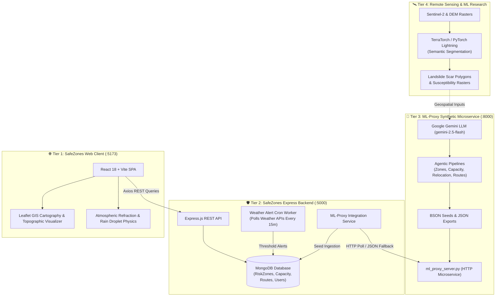

# 🏔️ SafeZones — Multi-Hazard Landslide Risk Intelligence Protocol

> **Smart India Hackathon (SIH26191) — Geospatial Decision Support, Cartographic Terrain Analysis & AI Disaster Response**

[](frontend/README.md)
[](backend/README.md)
[](ml-proxy/README.md)
[](ML/README.md)
[](LICENSE)

---

## 📋 Table of Contents

- [Overview](#-overview)
- [System Architecture](#-system-architecture)
- [📂 Modules & Comprehensive Documentation](#-modules--comprehensive-documentation)
- [🌟 Core Platform Capabilities](#-core-platform-capabilities)
- [⚡ Quick Start & Full-Stack Orchestration](#-quick-start--full-stack-orchestration)
  - [1. Prerequisites](#1-prerequisites)
  - [2. Start ML-Proxy Microservice](#2-start-ml-proxy-microservice)
  - [3. Start Backend REST API](#3-start-backend-rest-api)
  - [4. Start Frontend GIS Web App](#4-start-frontend-gis-web-app)
  - [5. Synchronize ML Datasets](#5-synchronize-ml-datasets)
- [🌐 Service Ports & Network Topology](#-service-ports--network-topology)
- [Repository Structure](#-repository-structure)
- [License](#-license)

---

## 🧭 Overview

**SafeZones** is an integrated disaster risk intelligence, cartographic terrain modeling, and emergency evacuation platform engineered to mitigate landslide hazards across high-risk mountainous regions in India (e.g., Wayanad, Chamoli, Shimla, Darjeeling).

By synthesizing **satellite remote sensing foundation models**, **agentic LLM risk parameters**, **real-time weather telemetry**, and **GIS cartography**, SafeZones equips emergency responders, district magistrates, and urban planners with actionable, life-saving decision support before, during, and after mass wasting events.

---

## 🏗️ System Architecture



---

## 📂 Modules & Comprehensive Documentation

Each component of SafeZones is fully documented in its respective directory:

| Module | Purpose & Technologies | Direct Link |
| :--- | :--- | :--- |
| **`frontend`** | **GIS Web Application**: React 18, Vite, Tailwind CSS, Leaflet cartography, real-time rain screen effects, settlement risk maps, and decision support interfaces. | 📖 [**Frontend Documentation**](frontend/README.md) |
| **`backend`** | **Core REST API**: Node.js, Express, MongoDB (Mongoose), JWT & Google OAuth 2.0, automated 15-minute meteorological alert cron, and disaster services. | 📖 [**Backend Documentation**](backend/README.md) |
| **`ml-proxy`** | **Synthetic Data Microservice**: Python, Google Gemini agentic LLM generator, schema validators, BSON/JSON exporters, and HTTP REST server on port 8000. | 📖 [**ML-Proxy Documentation**](ml-proxy/README.md) |
| **`ML`** | **Remote Sensing Research**: Geospatial foundation models (TerraTorch, Prithvi, TorchGeo), PyTorch Lightning, Rasterio, and semantic segmentation notebooks (`bacha.ipynb`). | 📖 [**ML Research Documentation**](ML/README.md) |

---

## 🌟 Core Platform Capabilities

1. **Multi-Hazard Active Risk Zones (`/risk-zone-id`)**:
   - High-precision terrain classification, slope stability scoring, soil saturation indices, and historical landslide frequency tracking.
2. **Dynamic Evacuation Corridors (`/evacuation-route`)**:
   - Safe path routing avoiding high-risk talus slopes, bottleneck identification, elevation profiling, and emergency shelter routing.
3. **Settlement Carrying Capacity Simulation (`/carrying-capacity`)**:
   - Resource strain modeling (drinking water, emergency medical beds, electricity, safe land area) under sudden population evacuation surges.
4. **Relocation Priority Decision Matrix (`/relocation-priority`)**:
   - Weighted multi-criteria ranking scoring habitation vulnerability, mobility-constrained populations, and shelter allocations.
5. **Real-Time Sensor & Weather Alarms (`/risk-alerts`)**:
   - Background daemon monitoring precipitation intensity, humidity, and rainfall accumulations with automatic alarm generation.
6. **Cartographic GIS Risk Map (`/settlement-risk-map`)**:
   - Leaflet map rendering settlement clusters, hazard buffer rings, safe shelters, and live telemetry badges.

---

## ⚡ Quick Start & Full-Stack Orchestration

Follow these steps to run the entire SafeZones stack locally:

### 1. Prerequisites
- **Node.js**: v18+ & **npm**: v9+
- **Python**: 3.10+
- **MongoDB**: Community server running locally on `mongodb://localhost:27017`

---

### 2. Start ML-Proxy Microservice

In a new terminal:
```bash
cd ml-proxy
python -m venv myenv
# Windows:
.\myenv\Scripts\activate
# Linux/macOS:
# source myenv/bin/activate

pip install -r requirements.txt
cp .env.example .env

# Run microservice server on port 8000
python ml_proxy_server.py
```
> Running at `http://localhost:8000`

---

### 3. Start Backend REST API

In a second terminal:
```bash
cd backend
npm install
cp .env.example .env

# Start dev server with nodemon
npm run dev
```
> Running at `http://localhost:5000`

---

### 4. Start Frontend GIS Web App

In a third terminal:
```bash
cd frontend
npm install
npm run dev
```
> Running at `http://localhost:5173`

---

### 5. Synchronize ML Datasets

Once the services are active, ingest the ML datasets into MongoDB:

```bash
# Trigger database sync via backend endpoint
curl -X POST http://localhost:5000/api/v1/ml-proxy/sync
```

Or open the frontend in your browser:
👉 **[http://localhost:5173](http://localhost:5173)**

---

## 🌐 Service Ports & Network Topology

| Component | Default URL | Environment Port Variable | Description |
| :--- | :--- | :--- | :--- |
| **Frontend** | `http://localhost:5173` | Vite default | React Single Page Application |
| **Backend API** | `http://localhost:5000` | `PORT=5000` | Node.js / Express Core REST API |
| **ML-Proxy** | `http://localhost:8000` | `ML_PROXY_PORT=8000` | Python Data Serving Microservice |
| **MongoDB** | `mongodb://localhost:27017`| `MONGO_URI` | Document Database |

---

## 📁 Repository Structure

```text
SIH26191/
├── README.md                  # Master project documentation (you are here)
├── LICENSE                    # Open-source license (MIT)
│
├── frontend/                  # React 18, Vite, Leaflet, Tailwind CSS web application
│   ├── README.md              # Detailed frontend guide & UI component documentation
│   ├── src/                   # Pages, components, hooks, assets
│   └── package.json
│
├── backend/                   # Node.js & Express RESTful API
│   ├── README.md              # Comprehensive API reference & route documentation
│   ├── src/                   # Feature modules, auth, schedulers, models
│   └── package.json
│
├── ml-proxy/                  # Python synthetic data generation & REST microservice
│   ├── README.md              # Pipeline walkthrough, CLI commands & schema guides
│   ├── ml_proxy_server.py     # Microservice server
│   ├── scripts/               # Gemini AI generation scripts (zones, routes, capacity)
│   ├── outputs/               # BSON seeds and JSON exports
│   └── requirements.txt
│
└── ML/                        # Deep learning & remote sensing research
    ├── README.md              # TerraTorch, TorchGeo & Earth observation documentation
    ├── bacha.ipynb            # Semantic segmentation training notebook
    └── requirements.txt
```

---

## 📄 License

This project is licensed under the **MIT License** — see the [LICENSE](LICENSE) file for details.