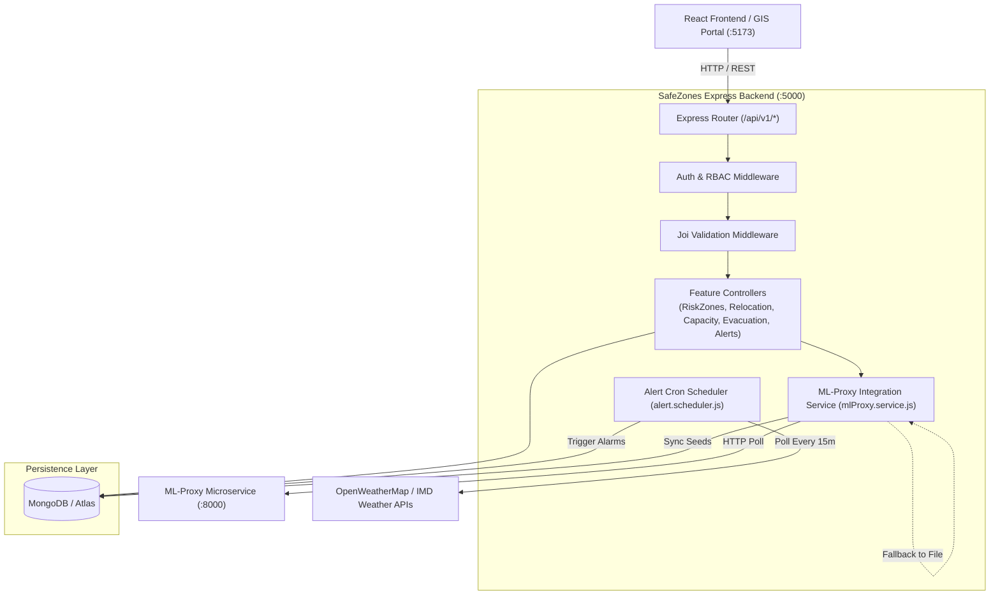

# 🛡️ SafeZones Backend API Documentation & Setup Guide

> **Node.js & Express RESTful API with MongoDB, JWT & Google OAuth, Disaster Risk Modeling & Real-Time Alert Engine**

[](https://nodejs.org/)
[](https://expressjs.com/)
[](https://www.mongodb.com/)
[](https://jwt.io/)
[](http://www.passportjs.org/)

---

## 📋 Table of Contents

- [Overview](#-overview)
- [System Architecture](#-system-architecture)
- [Key Features](#-key-features)
- [Tech Stack](#-tech-stack)
- [Prerequisites](#-prerequisites)
- [Getting Started & Setup](#-getting-started--setup)
- [Environment Configuration](#-environment-configuration)
- [Project Directory Structure](#-project-directory-structure)
- [API Endpoints Reference](#-api-endpoints-reference)
  - [1. Health Check (`/health`)](#1-health-check-health)
  - [2. Authentication (`/api/v1/auth`)](#2-authentication-apiv1auth)
  - [3. User Management (`/api/v1/users`)](#3-user-management-apiv1users)
  - [4. Multi-Hazard Risk Zones (`/api/v1/risk-zones`)](#4-multi-hazard-risk-zones-apiv1risk-zones)
  - [5. Relocation Priority Engine (`/api/v1/relocation`)](#5-relocation-priority-engine-apiv1relocation)
  - [6. Weather Alerts & Early Warning (`/api/v1/alerts`)](#6-weather-alerts--early-warning-apiv1alerts)
  - [7. Evacuation Corridors & Routing (`/api/v1/evacuation`)](#7-evacuation-corridors--routing-apiv1evacuation)
  - [8. Carrying Capacity Simulator (`/api/v1/capacity`)](#8-carrying-capacity-simulator-apiv1capacity)
  - [9. Settlement Risk Monitoring (`/api/v1/settlements`)](#9-settlement-risk-monitoring-apiv1settlements)
  - [10. ML-Proxy Bridge & Sync (`/api/v1/ml-proxy`)](#10-ml-proxy-bridge--sync-apiv1ml-proxy)
- [Automated Schedulers & Workers](#-automated-schedulers--workers)
- [Standard Response & Error Format](#-standard-response--error-format)
- [Available Scripts](#-available-scripts)

---

## 🧭 Overview

The **SafeZones Backend Service** is the central application server powering the SafeZones landslide risk intelligence and decision support platform. It manages identity and access control, orchestrates geospatial computations, ingests live meteorological data, evaluates automated early warning triggers, and coordinates data synchronization between machine learning services and MongoDB.

---

## 🏗️ System Architecture



---

## ✨ Key Features

- **Robust Identity & Access Management**:
  - Email/Password authentication with salted `bcryptjs` hashing.
  - Dual-token JWT lifecycle (15-min Access Tokens + 7-day Refresh Tokens).
  - Google OAuth 2.0 Single Sign-On (SSO) integration via Passport.
  - Role-Based Access Control (`user`, `officer`, `admin`).
- **Disaster Risk Intelligence**:
  - **Risk Zones**: Geospatial queries, GeoJSON polygon endpoints, historical landslide vulnerability metrics.
  - **Relocation Priorities**: Multi-criteria weighted scoring algorithm ranking vulnerable habitations and matching them to safe refuge sectors.
  - **Carrying Capacity**: Computes ecological and municipal thresholds (water, electricity, medical beds, slope stability) under disaster surge stress.
  - **Evacuation Corridors**: Scored escape routes evaluating distance, transit duration, elevation gradients, and bottleneck risks.
  - **Settlement Monitoring**: Real-time vulnerability tracking and telemetry for localized habitations.
- **Automated Early Warning & Alerts**:
  - Background cron scheduler (`node-cron`) polling meteorological APIs every 15 minutes.
  - Multi-factor hazard evaluation: precipitation volume, rainfall intensity, soil saturation, and elevation slope stress.
  - Push dispatch capabilities via Twilio SMS and SMTP alerts.
- **Microservice Bridge (`ml-proxy`)**:
  - Transparent dual-layer loader that consumes live HTTP microservice data (`:8000`) or seamlessly falls back to static JSON export files.
  - Atomic database synchronizer updating all disaster collections with one command.

---

## 🛠️ Tech Stack

- **Runtime**: [Node.js](https://nodejs.org/) (ES Modules)
- **Framework**: [Express.js](https://expressjs.com/)
- **Database**: [MongoDB](https://www.mongodb.com/) with [Mongoose ODM](https://mongoosejs.com/)
- **Authentication**: `jsonwebtoken`, `passport`, `passport-google-oauth20`, `bcryptjs`
- **Validation**: [Joi](https://joi.dev/)
- **Scheduling**: [node-cron](https://github.com/node-cron/node-cron)
- **HTTP Client**: [Axios](https://axios-http.com/)
- **Security & Logging**: [Helmet](https://helmetjs.github.io/), [CORS](https://github.com/expressjs/cors), [Morgan](https://github.com/expressjs/morgan), [Winston](https://github.com/winstonjs/winston)

---

## ⚙️ Prerequisites

Ensure you have the following installed locally:
- **Node.js**: v18.x or higher
- **npm**: v9.x or higher
- **MongoDB**: Local MongoDB community instance running at `mongodb://127.0.0.1:27017` or a MongoDB Atlas URI

---

## 🚀 Getting Started & Setup

1. **Navigate to the Backend Directory**:
   ```bash
   cd backend
   ```

2. **Install Dependencies**:
   ```bash
   npm install
   ```

3. **Configure Environment Variables**:
   ```bash
   cp .env.example .env
   ```

4. **Start the Application**:
   ```bash
   # Development mode with nodemon hot-reloading
   npm run dev

   # Production mode
   npm start
   ```

> The server will start at `http://localhost:5000`

---

## ⚙️ Environment Configuration

| Variable | Description | Default / Example |
| :--- | :--- | :--- |
| `PORT` | Server listening port | `5000` |
| `NODE_ENV` | Environment mode | `development` |
| `CLIENT_URL` | Allowed client origin for CORS | `http://localhost:5173` |
| `MONGO_URI` | MongoDB connection URI | `mongodb://127.0.0.1:27017/resqsense` |
| `JWT_ACCESS_SECRET` | Secret key for access token signing | `your_access_secret` |
| `JWT_ACCESS_EXPIRES_IN`| Lifespan of access token | `15m` |
| `JWT_REFRESH_SECRET` | Secret key for refresh token signing | `your_refresh_secret` |
| `JWT_REFRESH_EXPIRES_IN`| Lifespan of refresh token | `7d` |
| `GOOGLE_CLIENT_ID` | Google OAuth client ID | `your_id.apps.googleusercontent.com` |
| `GOOGLE_CLIENT_SECRET`| Google OAuth client secret | `your_secret` |
| `GOOGLE_CALLBACK_URL` | Google OAuth redirect callback | `http://localhost:5000/api/v1/auth/google/callback`|
| `ML_PROXY_URL` | Base URL for ML-Proxy microservice | `http://localhost:8000` |
| `OPENWEATHER_API_KEY` | OpenWeatherMap API key for live scans | `your_openweather_key` |
| `HAZARD_ALERT_THRESHOLD`| Minimum score to trigger emergency alert | `60` |
| `WEATHER_ALERT_CRON_SCHEDULE` | Cron expression for telemetry scanner | `*/15 * * * *` |
| `WEATHER_ALERT_CRON_ENABLED` | Toggle for automated background scanner | `true` |

---

## 📂 Project Directory Structure

```text
backend/
├── src/
│   ├── app.js                         # Express app configuration & middleware pipeline
│   ├── server.js                      # HTTP server bootstrap & DB connection
│   │
│   ├── common/                        # Shared utilities and middlewares
│   │   ├── config/                    # Global configs (auth, database, env)
│   │   ├── errors/                    # Custom AppError & standardized error codes
│   │   ├── middlewares/               # Error handler, validation, rate limiting
│   │   └── utils/                     # Token signers, formatters, response helpers
│   │
│   ├── features/                      # Domain-driven feature modules
│   │   ├── auth/                      # Authentication & Google OAuth
│   │   ├── users/                     # User management & RBAC
│   │   ├── riskZones/                 # Multi-Hazard Risk Zones & GeoJSON
│   │   ├── relocation/                # Relocation priorities & safe shelter scoring
│   │   ├── alerts/                    # Sensor alerts & background weather scanner
│   │   ├── evacuation/                # Corridors, bottlenecks & route computation
│   │   ├── carryingCapacity/          # Resource strain & load saturation modeling
│   │   ├── settlements/               # Habitation monitoring & vulnerability index
│   │   └── mlProxy/                   # Bridge to Python ML microservice & seeds
│   │
│   └── routes/
│       └── routes.js                  # Master API v1 router mounting all features
│
├── package.json
└── README.md
```

---

## 📡 API Endpoints Reference

### Base URL
```text
http://localhost:5000
```

---

### 1. Health Check (`/health`)

| Method | Endpoint | Access | Description |
| :--- | :--- | :--- | :--- |
| `GET` | `/health` | Public | System uptime, timestamp, and health status |

---

### 2. Authentication (`/api/v1/auth`)

| Method | Endpoint | Access | Description |
| :--- | :--- | :--- | :--- |
| `POST` | `/api/v1/auth/register` | Public | Register new user with email & password |
| `POST` | `/api/v1/auth/login` | Public | Authenticate user; returns access + refresh tokens |
| `POST` | `/api/v1/auth/refresh-token` | Public | Refresh expired access token using refresh token |
| `POST` | `/api/v1/auth/logout` | Authenticated | Invalidate refresh token and clear cookies |
| `GET` | `/api/v1/auth/me` | Authenticated | Get current authenticated user session |
| `GET` | `/api/v1/auth/google` | Public | Initiate Google OAuth 2.0 flow |
| `GET` | `/api/v1/auth/google/callback`| Public | Google OAuth redirect callback handler |

---

### 3. User Management (`/api/v1/users`)

| Method | Endpoint | Access | Description |
| :--- | :--- | :--- | :--- |
| `GET` | `/api/v1/users/me` | User / Admin | Fetch own profile details |
| `PATCH`| `/api/v1/users/me` | User / Admin | Update own profile (name, avatar) |
| `GET` | `/api/v1/users` | Admin Only | Paginated list of registered users |
| `GET` | `/api/v1/users/:id` | Admin Only | Fetch user details by ID |
| `PATCH`| `/api/v1/users/:id` | Admin Only | Update specific user details or role |
| `DELETE`| `/api/v1/users/:id`| Admin Only | Remove user account |

---

### 4. Multi-Hazard Risk Zones (`/api/v1/risk-zones`)

| Method | Endpoint | Access | Description |
| :--- | :--- | :--- | :--- |
| `GET` | `/api/v1/risk-zones` | Public | List risk zones with filtering (region, riskLevel) |
| `GET` | `/api/v1/risk-zones/geojson` | Public | FeatureCollection GeoJSON payload for GIS map rendering |
| `GET` | `/api/v1/risk-zones/stats/summary`| Public | Summary counts: total zones, critical zones, pop at risk |
| `GET` | `/api/v1/risk-zones/:id` | Public | Detailed telemetry for a specific hazard zone |
| `POST` | `/api/v1/risk-zones` | Officer / Admin | Create a new monitored hazard zone |
| `PATCH`| `/api/v1/risk-zones/:id` | Officer / Admin | Update zone risk level, metrics, or boundary |
| `DELETE`| `/api/v1/risk-zones/:id`| Admin Only | Deactivate/remove a monitored zone |

---

### 5. Relocation Priority Engine (`/api/v1/relocation`)

| Method | Endpoint | Access | Description |
| :--- | :--- | :--- | :--- |
| `GET` | `/api/v1/relocation/options` | Public | Origin habitations, safe shelters & hazard centers |
| `GET` | `/api/v1/relocation/priorities` | Public | Ranked priority matrix sorted by urgency score |
| `POST` | `/api/v1/relocation/calculate` | Public | Run decision matrix: calculates optimal safe shelter & route |
| `GET` | `/api/v1/relocation/history` | Public | Audit log of previous relocation assessments |
| `GET` | `/api/v1/relocation/:id` | Public | Specific calculated relocation plan |

---

### 6. Weather Alerts & Early Warning (`/api/v1/alerts`)

| Method | Endpoint | Access | Description |
| :--- | :--- | :--- | :--- |
| `POST` | `/api/v1/alerts/scan` | Public | Run on-demand weather scan across monitored districts |
| `GET` | `/api/v1/alerts/telemetry` | Public | Live atmospheric telemetry (rainfall, humidity, wind) |
| `GET` | `/api/v1/alerts` | Public | Paginated list of active early warnings and alerts |
| `GET` | `/api/v1/alerts/:id` | Public | Specific alert telemetry & triggered metrics |
| `PATCH`| `/api/v1/alerts/:id/dismiss` | Officer / Admin | Acknowledge or dismiss an active hazard alert |

---

### 7. Evacuation Corridors & Routing (`/api/v1/evacuation`)

| Method | Endpoint | Access | Description |
| :--- | :--- | :--- | :--- |
| `GET` | `/api/v1/evacuation/options` | Public | Origins, muster points, and intermediate waypoints |
| `GET` | `/api/v1/evacuation/routes` | Public | Precomputed safe routes with bottlenecks & safety ratings |
| `POST` | `/api/v1/evacuation/calculate` | Public | Dynamic route corridor solver minimizing slope hazard |
| `GET` | `/api/v1/evacuation/plans` | Public | Recent evacuation action plans |

---

### 8. Carrying Capacity Simulator (`/api/v1/capacity`)

| Method | Endpoint | Access | Description |
| :--- | :--- | :--- | :--- |
| `GET` | `/api/v1/capacity/sectors` | Public | Municipal refuge sectors with baseline capacity limits |
| `POST` | `/api/v1/capacity/calculate` | Public | Simulate population surge: water, medical, stress level |
| `GET` | `/api/v1/capacity/history` | Public | Past capacity assessments & historical saturation |

---

### 9. Settlement Risk Monitoring (`/api/v1/settlements`)

| Method | Endpoint | Access | Description |
| :--- | :--- | :--- | :--- |
| `GET` | `/api/v1/settlements` | Public | List settlements with risk level, progress & coordinates |
| `GET` | `/api/v1/settlements/stats/summary`| Public | Aggregate statistics: critical settlements, population |
| `GET` | `/api/v1/settlements/:id` | Public | Fetch individual settlement risk profile |
| `POST` | `/api/v1/settlements` | Officer / Admin | Register new habitation for geospatial monitoring |
| `PATCH`| `/api/v1/settlements/:id` | Officer / Admin | Update habitation vulnerability score |
| `DELETE`| `/api/v1/settlements/:id`| Admin Only | Deactivate settlement tracking |

---

### 10. ML-Proxy Bridge & Sync (`/api/v1/ml-proxy`)

| Method | Endpoint | Access | Description |
| :--- | :--- | :--- | :--- |
| `POST` | `/api/v1/ml-proxy/sync` | Public | Ingests all ML-Proxy data directly into MongoDB |
| `GET` | `/api/v1/ml-proxy/status` | Public | Connection status and collection document counts |
| `GET` | `/api/v1/ml-proxy/data/:dataset`| Public | Fetch raw dataset (`risk-zones`, `capacity`, `relocation`, `routes`)|

---

## ⏰ Automated Schedulers & Workers

The backend incorporates background workers managed via [`alert.scheduler.js`](file:///d:/codings/hackathon/SIH26191/backend/src/features/alerts/alert.scheduler.js):
- **Cron Frequency**: Runs every 15 minutes (`*/15 * * * *`) when enabled by `WEATHER_ALERT_CRON_ENABLED=true`.
- **Telemetry Scan**: Queries OpenWeatherMap for monitored hill stations (Wayanad, Chamoli, Shimla, Darjeeling, etc.).
- **Hazard Formula**: Evaluates cumulative precipitation + rainfall intensity + historical slope vulnerability.
- **Auto-Alarm**: If composite hazard score exceeds `HAZARD_ALERT_THRESHOLD` (default: 60), an alert is generated and dispatched.

---

## 📦 Standard Response & Error Format

### Standard Success Response
```json
{
  "success": true,
  "statusCode": 200,
  "message": "Resource retrieved successfully",
  "data": { ... }
}
```

### Standard Error Response
```json
{
  "success": false,
  "statusCode": 400,
  "message": "Validation error",
  "errors": [
    {
      "field": "email",
      "message": "\"email\" must be a valid email"
    }
  ]
}
```

---

## 🧪 Available Scripts

| Script | Command | Description |
| :--- | :--- | :--- |
| **Development** | `npm run dev` | Starts server with `nodemon` hot reloading |
| **Production** | `npm start` | Starts server with production `node src/server.js` |
| **Test** | `npm test` | Executes backend test suite |
