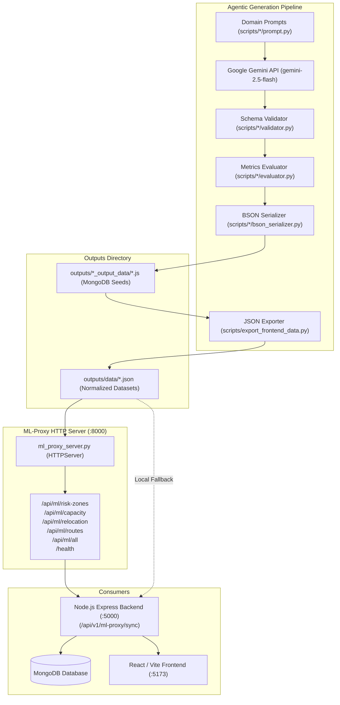

# 🤖 ML-Proxy — Disaster Risk Intelligence & Synthetic Data Microservice

> **Agentic LLM-Powered Hazard Synthesis, Geospatial Validation & REST Data Microservice**

[](https://www.python.org/)
[](https://ai.google.dev/)
[](https://geojson.org/)
[](https://json-schema.org/)

---

## 📋 Table of Contents

- [Overview](#-overview)
- [System Architecture](#-system-architecture)
- [Directory Structure](#-directory-structure)
- [Data Domains & Pipelines](#-data-domains--pipelines)
  - [1. Multi-Hazard Risk Zones](#1-multi-hazard-risk-zones)
  - [2. Carrying Capacity Assessments](#2-carrying-capacity-assessments)
  - [3. Relocation Priority Rankings](#3-relocation-priority-rankings)
  - [4. Evacuation Corridors & Routes](#4-evacuation-corridors--routes)
- [REST Microservice API](#-rest-microservice-api)
- [Getting Started & Setup](#-getting-started--setup)
  - [Prerequisites](#prerequisites)
  - [Installation](#installation)
  - [Environment Configuration](#environment-configuration)
- [CLI Pipeline Execution](#-cli-pipeline-execution)
- [Backend Integration & Fallback Strategy](#-backend-integration--fallback-strategy)
- [Testing & Quality Assurance](#-testing--quality-assurance)

---

## 🧭 Overview

**ML-Proxy** is a specialized Python data generation and serving microservice for the **SafeZones** platform. It solves the critical data-scarcity challenge in disaster risk intelligence by pairing **Google Gemini LLM reasoning** with strict **deterministic validation schemas** and **BSON/JSON serializers**.

ML-Proxy provides:
1. **Agentic Synthetic Data Generation**: Synthesizes realistic geological, demographic, and risk-index parameters for high-risk landslide regions across India (e.g., Wayanad, Chamoli, Shimla, Darjeeling, Idukki, Nilgiris).
2. **Deterministic Validation & Sanitization**: Validates geographic bounds, coordinate integrity, population statistics, and stress formulas using JSON Schema and custom evaluators.
3. **Dual Export Formats**: Generates both native MongoDB BSON `.js` seed scripts and standard formatted `.json` files.
4. **Lightweight HTTP Microservice**: Zero-dependency REST API (`ml_proxy_server.py`) serving live datasets with full CORS support to the Express backend and React frontend.

---

## 🏗️ System Architecture



---

## 📂 Directory Structure

```text
ml-proxy/
├── ml_proxy_server.py         # Lightweight HTTP REST microservice (port 8000)
├── requirements.txt           # Python dependencies (google-genai, jsonschema, etc.)
├── .env.example               # Template environment configuration
├── .gitignore                 # Git ignore rules for virtualenv and outputs
│
├── scripts/                   # Core pipeline and data generation logic
│   ├── generate_zones.py      # CLI generator for Multi-Hazard Risk Zones
│   ├── generate_capacity.py   # CLI generator for Sector Carrying Capacity
│   ├── generate_relocation.py # CLI generator for Relocation Priorities
│   ├── generate_routes.py     # CLI generator for Evacuation Corridors
│   ├── update_routes_and_relocation.py # End-to-end master synchronization pipeline
│   ├── export_frontend_data.py# Parser converting BSON JS seed files into clean JSON
│   │
│   ├── generator/             # Risk Zone generation module
│   │   ├── client.py          # Gemini API client wrapper & retry loop
│   │   ├── config.py          # Target regions, prompt limits & model IDs
│   │   ├── prompt.py          # Few-shot prompts for terrain hazard attributes
│   │   ├── validator.py       # Strict schema & coordinate boundary checks
│   │   └── bson_serializer.py # Serializes to MongoDB BSON shell format
│   │
│   ├── capacity/              # Carrying Capacity module
│   │   ├── client.py          # API invocation for municipal capacity
│   │   ├── config.py          # Baseline sector definitions
│   │   ├── evaluator.py       # Formula: saturation, stress score & threshold
│   │   ├── prompt.py          # Capacity assessment guidelines
│   │   └── bson_serializer.py # Serializer for CapacitySector collection
│   │
│   ├── relocation/            # Relocation Priorities module
│   │   ├── client.py          # Habitation vulnerability generator
│   │   ├── config.py          # Priority tier configs (CRITICAL, HIGH, MEDIUM)
│   │   ├── evaluator.py       # Priority scoring algorithms
│   │   └── bson_serializer.py # Serializer for RelocationPriority collection
│   │
│   └── route/                 # Evacuation Route module
│       ├── client.py          # Safe corridor generator
│       ├── config.py          # Road conditions, transit parameters
│       ├── evaluator.py       # Safety score and bottleneck penalty model
│       └── bson_serializer.py # Serializer for EvacuationLocation collection
│
├── outputs/                   # Generated artifacts
│   ├── data/                  # Final normalized JSON files served by HTTP
│   │   ├── riskZones.json
│   │   ├── carryingCapacity.json
│   │   ├── relocationPriorities.json
│   │   └── evacuationRoutes.json
│   ├── risk_zone_output_data/ # Raw BSON JavaScript seed files for risk zones
│   ├── capacity_output_data/  # Raw BSON JavaScript seed files for capacity
│   ├── relocation_output_data/# Raw BSON JavaScript seed files for relocation
│   └── route_output_data/     # Raw BSON JavaScript seed files for routes
│
└── tests/                     # Pipeline unit tests
    └── test_pipeline.py       # Verification for parsers, validators & serializers
```

---

## 🔬 Data Domains & Pipelines

### 1. Multi-Hazard Risk Zones
- **Focus**: Landslide susceptibility, slope degree, flash-flood risks, soil saturation, and active seismic fault proximities.
- **Key Attributes**:
  - `zoneId`, `name`, `region`, `hazardTypes`, `riskLevel` (`critical`, `warning`, `safe`)
  - `vulnerabilityScore` (0–100), `severityIndex` (1–10)
  - `population`, `households`, `radiusMeters`
  - `center`: GeoJSON `Point` coordinates `[longitude, latitude]`
- **Script**: `python scripts/generate_zones.py`

### 2. Carrying Capacity Assessments
- **Focus**: Evaluates whether municipal refuge sectors and shelters can safely accommodate displaced populations.
- **Key Attributes**:
  - `assessmentId`, `sectorName`, `currentPopulation`, `maxSafeCapacity`, `availableCapacity`
  - Resource allocations: `waterSupplyLitersDay`, `electricitySupplyMw`, `housingUnits`, `medicalBeds`
  - `stressLevel`: `NORMAL`, `ELEVATED`, `HIGH`, `CRITICAL`
- **Script**: `python scripts/generate_capacity.py`

### 3. Relocation Priority Rankings
- **Focus**: Multi-criteria ranking identifying vulnerable habitations requiring immediate evacuation.
- **Key Attributes**:
  - `relocationId`, `zoneId`, `habitationName`, `vulnerablePopulation`, `mobilityConstrainedCount`
  - `priorityRank`, `priorityTier` (`CRITICAL_IMMEDIATE`, `HIGH_PRIORITY`, `MEDIUM_PRIORITY`)
  - `destinationRefugeSector`, `allocatedShelterBeds`, `status`
- **Script**: `python scripts/generate_relocation.py`

### 4. Evacuation Corridors & Routes
- **Focus**: Safe transit paths between origin habitations and designated safe refuge sectors.
- **Key Attributes**:
  - `routeId`, `routeName`, `distanceKm`, `estimatedTransitMinutes`
  - `originCoordinates` & `destinationCoordinates`
  - `safetyScore` (1.0–10.0), `status` (`ACTIVE_SAFE`, `CAUTION`, `IMPASSABLE`)
- **Script**: `python scripts/generate_routes.py`

---

## ⚡ REST Microservice API

The microservice runs an asynchronous HTTP server on **port 8000** (or `ML_PROXY_PORT`), with full CORS headers enabled.

### Base URL
```text
http://localhost:8000
```

### Endpoints

| Method | Endpoint | Description |
| :--- | :--- | :--- |
| `GET` | `/health` | Healthcheck and counts of all loaded dataset items |
| `GET` | `/api/ml/risk-zones` | Returns all normalized Multi-Hazard Risk Zones |
| `GET` | `/api/ml/capacity` | Returns Carrying Capacity sector assessments |
| `GET` | `/api/ml/relocation` | Returns ranked Relocation Priorities |
| `GET` | `/api/ml/routes` | Returns Evacuation Routes and corridor safety |
| `GET` | `/api/ml/all` | Aggregated payload containing all 4 dataset domains |
| `POST`| `/api/ml/sync` | Re-reads files from disk and responds with fresh counts |

#### Example: Health Check
```bash
curl http://localhost:8000/health
```

**Response**:
```json
{
  "status": "ok",
  "service": "ml-proxy-service",
  "counts": {
    "riskZones": 10,
    "carryingCapacity": 12,
    "relocationPriorities": 140,
    "evacuationRoutes": 204
  }
}
```

#### Example: Fetch Risk Zones
```bash
curl http://localhost:8000/api/ml/risk-zones
```

---

## 🚀 Getting Started & Setup

### Prerequisites
- **Python 3.10** or higher
- A **Google Gemini API Key** (for running new AI data generation cycles)

### Installation

1. Navigate to the `ml-proxy` directory:
   ```bash
   cd ml-proxy
   ```

2. Create and activate a Python virtual environment:
   ```bash
   # Windows (PowerShell)
   python -m venv myenv
   .\myenv\Scripts\Activate.ps1

   # Windows (Command Prompt)
   myenv\Scripts\activate.bat

   # macOS/Linux
   python3 -m venv myenv
   source myenv/bin/activate
   ```

3. Install required dependencies:
   ```bash
   pip install -r requirements.txt
   ```

### Environment Configuration

Copy the example environment file:
```bash
cp .env.example .env
```

Edit `.env` to configure your keys:
```env
# Google Gemini API Key (required for generation scripts)
GEMINI_API_KEY=your_gemini_api_key_here

# Microservice port (default: 8000)
ML_PROXY_PORT=8000

# Optional MongoDB URI if executing direct BSON insertion
# MONGO_URI=mongodb://localhost:27017/resqsense
```

---

## 🖥️ CLI Pipeline Execution

### Running the Microservice Server
```bash
# Default port 8000
python ml_proxy_server.py

# Custom port
python ml_proxy_server.py --port 8080
```

### Running Data Generation Scripts
To regenerate or synthesize fresh datasets with Gemini:

```bash
# 1. Generate Risk Zones for default regions (Wayanad, Chamoli, etc.)
python scripts/generate_zones.py

# 2. Generate Carrying Capacity for designated refuge sectors
python scripts/generate_capacity.py

# 3. Generate Relocation Priorities
python scripts/generate_relocation.py

# 4. Generate Evacuation Routes
python scripts/generate_routes.py

# 5. Run the Master Orchestrator (regenerates routes & relocation end-to-end)
python scripts/update_routes_and_relocation.py

# 6. Export all raw BSON outputs to outputs/data/*.json for the server
python scripts/export_frontend_data.py
```

---

## 🔗 Backend Integration & Fallback Strategy

The Node.js/Express backend integrates with `ml-proxy` via [`mlProxy.service.js`](file:///d:/codings/hackathon/SIH26191/backend/src/features/mlProxy/mlProxy.service.js):

1. **Live Microservice First**: The backend queries `http://localhost:8000/api/ml/*`. If the Python microservice is running, live data is retrieved directly.
2. **Local File Fallback**: If the microservice is offline or unreachable, the service transparently falls back to loading the static JSON files located at `outputs/data/*.json`.
3. **Database Ingestion**: Triggering `POST /api/v1/ml-proxy/sync` on the Express backend ingests and normalizes the ML dataset into MongoDB collections:
   - `RiskZone`
   - `Settlement`
   - `CapacitySector` & `CapacityAssessment`
   - `RelocationPriority` & `RelocationLocation`
   - `EvacuationLocation`

---

## 🧪 Testing & Quality Assurance

A dedicated unit test suite validates JSON markdown extraction, schema compliance, evaluator math, and BSON serialization:

```bash
# Run the test suite
python -m unittest tests/test_pipeline.py
```

### Test Coverage Highlights
- `test_extract_json_markdown`: Validates markdown code block stripping and raw JSON parsing.
- `test_validate_zone_data_valid`: Checks numerical normalization and schema validation.
- `test_calculate_capacity_metrics`: Validates saturation percent, water limits, and stress classification.
- `test_calculate_priority_score`: Ensures relocation vulnerability weighting is mathematically consistent.
- `test_parse_risk_zone_file`: Validates BSON-to-JSON regex parsing accuracy.
